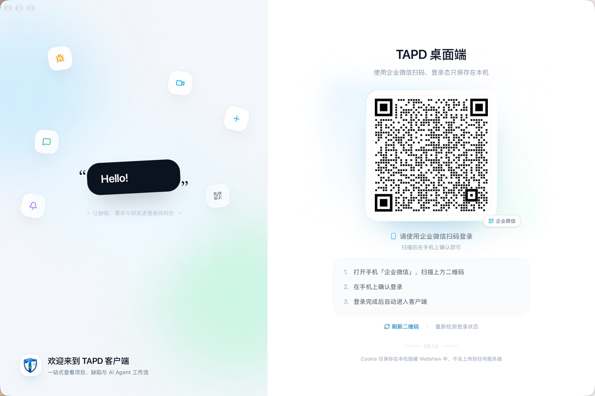

<div align="center">


# TAPD Client

**一个窗口，交付 TAPD 的全部工作。**

缺陷 · 通知 · 本地事项 · 内置 Agent · 文件与终端 · 手机伴侣

<p>
  <a href="https://github.com/wwog/tapd_client/releases/latest">
    
  </a>
  <a href="docs/MCP.md">
    
  </a>
  <a href="CHANGELOG.md">
    
  </a>
</p>



</div>

---

## 它解决什么

TAPD 里的活，一半在工单系统，一半在代码里。TAPD Client 把这两半放进同一个窗口，并且让 Agent 真正走完中间那段路。

- **缺陷不用回浏览器**——列表、筛选、详情、评论、流转、通知都在客户端；谁改了什么都看得见。
- **修复不用离开上下文**——从缺陷详情直接交给 Agent，它在独立 worktree 里改代码，人审核后自动合并并回写 TAPD。
- **能力不止在这台机器**——在手机上，它就是同一个客户端的移动版。不开客户端时，MCP 把同一套查询与回写能力交给任意外部 Agent；

---

## 提示「已损坏，无法打开」是未签名导致，执行一次 `xattr -cr "/Applications/TAPD Client.app"` 再打开。

---

## 1 · 内置 Agent：为 TAPD 工作流深度适配

一条闭环，从缺陷到回写：

```text
缺陷详情「交给 Agent」
      │
      ▼
独立 worktree 执行 ──► 改动提交审核 ──► 人看 diff ──► 通过
                                                      │
                          提交 · 合并 · 清理 worktree · 回写 TAPD
```

- **执行阶段只碰代码**：模型看不到任何 TAPD 工具（连工具名都不出现在 schema 与提示词里）；审核通过进入收尾阶段，回写工具才条件出现。
- **审核是真的审核**：改动文件清单、逐个 diff、「应用内查看」打开内置编辑器；通过 / 搁置 / 继续修改，全部在一个页面。
- **队列而不是一次性**：并行 1–8 个任务，跨项目的工作流队列（执行中 · 已中断 · 队列中 · 待审核 · 收尾中），批次结束给完成报告。
- **中断能接着跑**：任务中断记入「已中断」，一条提示词续跑；失败回调用引擎自身日志重试，不重复塞提示词。
- **人的位置保留**：三档权限（自主 / 变更前通知 / 完全访问）、计划模式、审批与提问弹在顶部胶囊里——手机上也能回答。
- **团队可选**：同事技能包渲染成 agent preset 供 lead 指派，团队任务板默认关闭；模型支持多供应商、每模型独立推理强度、会话级选择。

## 2 · 基于 worktree 的修复流程：主仓库永远在你手上

- **一个任务一个独立 git worktree**，任务之间物理隔离，并行再多也不互相踩。
- **写回主仓库只有一个串行队列**，一次一个；执行期间不 push 远端，合并只发生在审核通过之后。
- **审核不通过 = 丢弃 worktree**，没有半成品需要手工回滚，也不会留下冲突现场。
- **收尾可恢复**：失败可单独重试收尾，5 分钟看门狗兜底，应用重启自动恢复收尾中 / 已中断的任务。
- **每一步留痕**：任务页给出分支、改动行数、合并 hash 与回写结果，事后可查。

## 3 · 唯一工作台

| 区域 | 能力 |
| --- | --- |
| 项目与缺陷 | 多项目列表；表格列显隐与拖动排序；表头筛选（状态 / 处理人 / 优先级 / 严重程度 / 创建人，支持多选与匹配）；我负责的 / 全部 |
| 缺陷详情 | 描述与内嵌截图、评论、状态流转、认领与处理人转移、成员目录、交给 Agent |
| 通知 | 30 秒轮询 + 顶部胶囊；免打扰时段；AI / MCP 也能唤起通知并等待你的回执 |
| 本地项目与事项 | 与 TAPD 无关的事项同样可以交给同一个 Agent，状态随任务实时刷新 |
| 工作区 | 多标签分屏、文件树、Monaco 编辑、底部多 Tab 终端、Agent 会话与轨迹面板 |
| 外观 | 浅色 / 深色 / 跟随系统、字号、中英双语、启动检查更新（之后每 30 分钟） |

## 4 · MCP：不用客户端，外部 Agent 也能用

桌面端跑一个独立 stdio sidecar（`tapd-mcp`），复用客户端已登录的会话、筛选与导出，把能力交给任意 AI 客户端：

- **10 个工具**：`whoami`、项目 / 缺陷查询、我的缺陷、详情导出（修复包 + 提示词）、状态机查询、评论与状态回写、桌面胶囊通知与回执。
- **一键导入 9 个客户端**：opencode、ZCode、Claude Code、Cursor、Codex、OMP、Kimi Code、Gemini CLI、Qwen Code——写用户级配置，幂等，改前自动备份。
- **`get_bug` 直接给一套修复上下文**：`bug.json` + 下载好的截图 / 附件 + 修复提示词 + 技能包 + 项目规则。
- **能找人**：`tapd_notify_user` 把结果推到屏幕顶部胶囊，等用户点按钮再回传 `actionId`。

详见 [docs/MCP.md](docs/MCP.md)。

## 5 · 移动端：几乎就是整个客户端

桌面端运行着，手机扫码即用。手机不持有 TAPD 凭据、不直接连 TAPD——它是这**台机器的第二个屏幕**，数据与动作都由桌面执行。

- **缺陷与事项**：列表、筛选、排序、分页、详情、评论、认领、转移处理人、交给 Agent（可附说明与选模型）。
- **Agent 全流程**：任务与队列、审核（diff 就地展开 / 打开文件）、审批与提问、失败重试、继续中断任务、模型信息。
- **文件与终端**：桌面项目文件浏览、编辑（默认关闭）、图片与音视频预览；远程终端直连桌面 PTY（行输入 / 直通两种模式）。
- **通知**：与桌面同一批，点通知直接进缺陷；HTTPS 下走系统通知。
- **外网可用**：默认 Quick Tunnel（`cloudflared`），不在同一 Wi-Fi 也能扫码进；局域网直连作为测试通道。

详见 [docs/COMPANION.md](docs/COMPANION.md)。

---

## 下载与使用

[下载 TAPD Client](https://github.com/wwog/tapd_client/releases/latest) · macOS 11+ · Apple Silicon · 自动更新


## 文档

| 文档 | 内容 |
| --- | --- |
| [ARCHITECTURE.md](docs/ARCHITECTURE.md) | 整体架构与模块边界 |
| [DSH.md](docs/DSH.md) | 内置 Agent 运行时（dsh）与桥接 |
| [AGENT_TASK_FLOW.md](docs/AGENT_TASK_FLOW.md) | 任务状态机、审核与回写契约 |
| [MCP.md](docs/MCP.md) | MCP 工具、导入与通知协议 |
| [COMPANION.md](docs/COMPANION.md) | 手机伴侣、隧道与远程终端 |
| [WORKBENCH.md](docs/WORKBENCH.md) | 工作区布局、标签与拖拽协议 |
| [DEVELOPMENT.md](docs/DEVELOPMENT.md) | 本地开发与构建 |
| [CHANGELOG.md](CHANGELOG.md) | 版本更新日志 |
